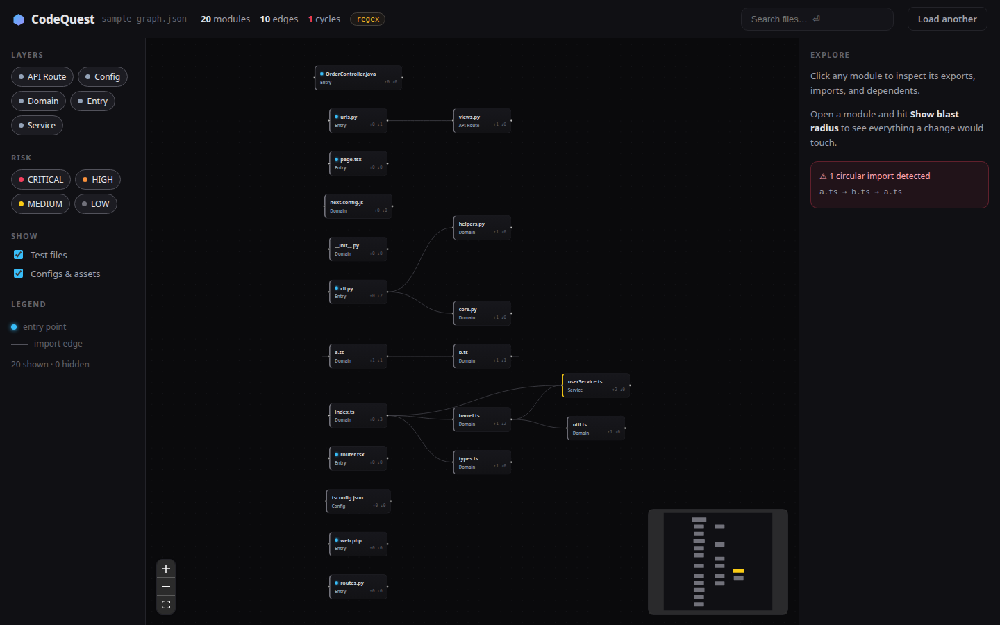
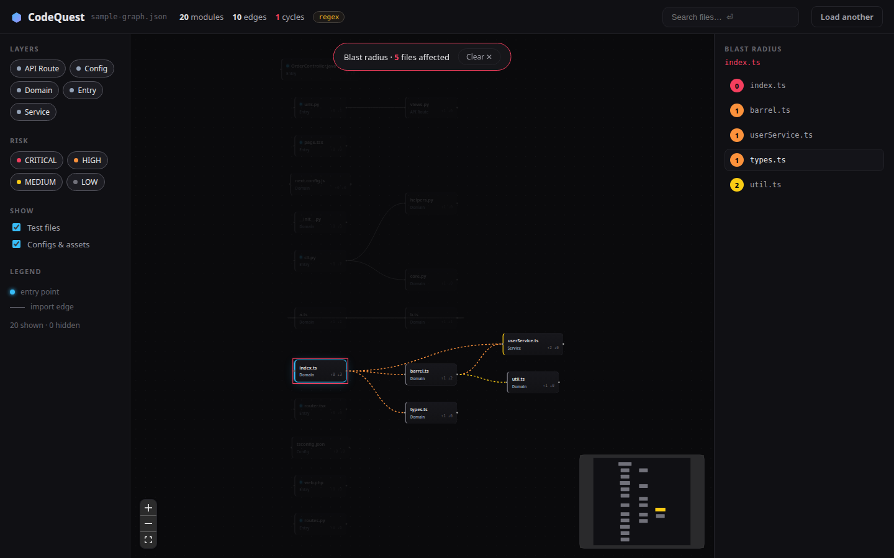
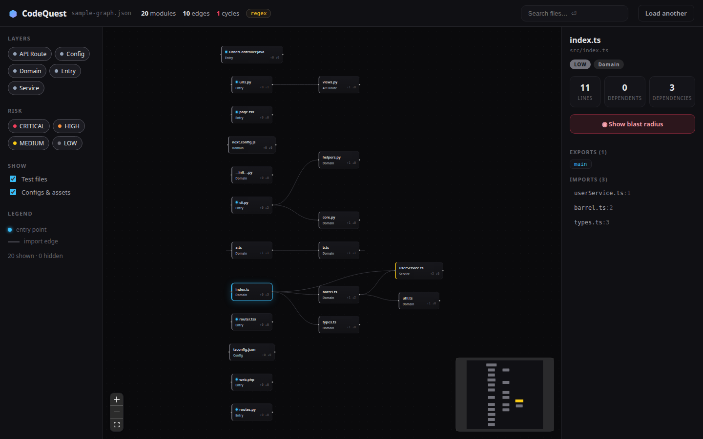

<div align="center">

# ⬢ CodeQuest

**Drop-in repo intelligence for GitHub Copilot.** A computed module graph, blast-radius
analysis, story traces, and CI drift gates — wired to any API via MCP. Your code never
leaves your machine.

[](https://github.com/abicevoice1-sudo/CodeQuest/actions/workflows/codequest.yml)
[](LICENSE)
[](https://nodejs.org/)
[](CHANGELOG.md)



*The visualizer: every module, every import, risk-scored — click any node to inspect it.*

</div>

## See it in action

| Blast-radius heatmap | Node inspector |
|---|---|
|  |  |
| Change one file → see everything it touches, by degree. | Exports, imports with line numbers, dependents. |

## The 60-second version

```bash
# Option A: install from npm (quickest)
npm install -g codequest-ai
cd /path/to/your-repo && codequest scan

# Option B: drop-in folder (full Copilot pack: prompts, skills, MCP server)
cp -r codequest /path/to/your-repo/
cd /path/to/your-repo && ./codequest/bin/codequest scan
```

# Then, with either option:
codequest start                  # the easy one: scan + set up your IDE + open the graph in your browser

# Or step by step:
codequest scan && codequest map  # terminal: build the graph, print the repo map
codequest visualize              # just the browser graph
./codequest/bin/codequest setup   # auto-configure your IDEs (VS Code, Cursor, Windsurf, Zed, …)

# Optional: set your audience (beginner/professional/expert, business lens)
./codequest/bin/codequest init --audience professional

# In your IDE, open the AI agent and run:
/codequest-onboard
```

Copilot reads `codequest/CODEQUEST.md` + the generated `.codequest/graph.json` and becomes the
CodeQuest AI: grounded in a computed module graph, incapable of hallucinating your dependencies.

## Requirements

- **Node.js 18+** — for the analyzer only. No `npm install`, zero dependencies, works offline.
- **VS Code + GitHub Copilot** (agent mode) — for the intelligence layer: slash prompts + skills.

## How the pieces run

1. **Analyzer (deterministic, offline).** `./codequest/bin/codequest scan` walks the repo,
   parses imports/exports (JS/TS, Python, Go, Java, Ruby, PHP), resolves them to files,
   and writes `.codequest/graph.json` (the module graph) + `.codequest/repo-map.md`.
   Other commands read that graph: `blast-radius` (upstream + downstream by degree, risk,
   affected tests), `story` (static trace from an entry point), `modules`, `map`.
   Add `--json` to any command for machine-readable output.
2. **Slash prompts (Copilot).** The files in `codequest/.github/prompts/` are Copilot-native
   `.prompt.md` prompts — agent mode picks them up automatically, so `/codequest-onboard`,
   `/codequest-map`, `/codequest-blast-radius`, `/codequest-story`, `/codequest-whatif`,
   and `/codequest-review` just work once the folder is in your repo.
3. **Skills (Copilot agent mode).** `codequest/skills/*/` are Agent Skills
   (`repo-cartographer`, `blast-radius`, `story-mode`, `what-if`) — invoke them from agent
   mode for the full workflows (scan → verify by reading → write the report).
4. **Instructions.** `codequest/.github/muse-instructions.md` auto-loads the CodeQuest boot
   sequence; `codequest/.github/instructions/` enforces the analysis + formatting rules on
   every file Copilot touches.
5. **MCP: Copilot-native tools + any API.** `codequest/mcp-server.js` exposes the analyzer
   as five MCP tools (`codequest_scan`, `codequest_blast_radius`, …) — copy
   `codequest/mcp.example.json` to your repo's `.vscode/mcp.json` and Copilot calls them
   natively. Your company can add its own API MCP servers (ticketing, docs, internal
   search) alongside — the agent mixes the repo graph with any API you plug in.
   Full guide: `docs/MCP.md`.

## What's in the pack

```
codequest/
├── CODEQUEST.md              # the master system prompt — the brain
├── AGENTS.md                 # agent operating notes
├── README.md                 # drop-in quickstart
├── package.json              # npm publishing (bin: codequest)
├── mcp-server.js             # the analyzer as MCP tools (Copilot calls them natively)
├── mcp.example.json          # MCP wiring: codequest + any API your company plugs in
├── .github/
│   ├── muse-instructions.md# auto-loaded Copilot instructions
│   ├── agents/               # custom agent: codequest.agent.md (CodeQuest Core AI)
│   ├── instructions/         # analysis + formatting rules (always applied)
│   └── prompts/              # /codequest-onboard, -map, -blast-radius, -story, -whatif, -review
├── skills/                   # Agent Skills: repo-cartographer, blast-radius, story-mode, what-if
├── bin/codequest             # CLI entry (thin — dispatches to lib/)
├── lib/                      # scan.js (graph engine) · commands.js · setup.js · util.js
├── parsers/tree-sitter/      # optional AST engine (scan --engine tree-sitter)
├── tests/                    # 19-test analyzer suite (node --test)
└── templates/                # report templates (blast-radius, story-mode, what-if, architecture, module-card)

visualizer/                   # interactive dependency-graph UI (React + dagre)
extensions/vscode/            # VS Code extension — ./build.sh packages the .vsix
```

## The loop

```
./codequest/bin/codequest scan        # deterministic: modules, imports, graph, risk scores
        │
        ▼
Copilot agent mode (/codequest-*)     # intelligence: summaries, narratives, judgment
        │
        ▼
.codequest/ + Markdown reports        # saved in-repo: offline, diffable, reviewable
```

## Analyzer commands

```bash
./codequest/bin/codequest scan [dir]            # build .codequest/graph.json + repo-map.md
./codequest/bin/codequest scan --engine tree-sitter   # AST-accurate parsing (JS/TS/TSX/Python)
./codequest/bin/codequest map [dir]             # print the repo map
./codequest/bin/codequest modules [dir]         # list modules + exports
./codequest/bin/codequest blast-radius <file>   # upstream, downstream by degree, risk, affected tests
./codequest/bin/codequest story <entry-file>    # static execution trace from an entry point
./codequest/bin/codequest diff <old> <new>      # architecture drift gate for CI (fails on new CRITICAL/cycles)
./codequest/bin/codequest history [dir]         # record a drift snapshot
./codequest/bin/codequest trends [dir]          # show drift history over time
# add --json to any command for machine-readable output
```

## Parser engines

- `regex` (default): zero-dependency, offline, 8 languages + config/doc/image/PDF inventory.
- `tree-sitter`: real AST parsing for JS/TS/TSX/Python — import statements identified
  structurally, zero false positives from comments/strings. Per-file fallback to regex for
  other languages. `cd codequest/parsers/tree-sitter && npm install`, then
  `codequest scan --engine tree-sitter`. Both engines emit the identical `graph.json` contract.

## Visualizer

`visualizer/` is a dark, interactive dependency-graph UI that reads any `graph.json`:
dagre layout, node inspector (exports/imports/dependents), **blast-radius heatmap**,
search, layer & risk filters. Run it:

```bash
cd visualizer && npm install && npm run dev     # then drop in .codequest/graph.json
```

## VS Code extension

`extensions/vscode/` — sidebar dependency graph, click-to-file, one-command rescan.
Install `extensions/vscode/codequest-1.1.0.vsix` via
`code --install-extension`, or build from source (see its README).

## Try it

`examples/sample-app/` is a tiny JS/Python service with real import chains. Run the scan there
and see `examples/outputs/` for what the analyzer produces.

## Docs

- `codequest/CODEQUEST.md` — master system prompt (start here to understand the AI's contract)
- `codequest/README.md` — drop-in quickstart for any repo
- `docs/PITCH.md` — pitch memo (v2: wedge, buyer, ROI, honest moat)
- `docs/MCP.md` — wire any API via MCP
- `docs/PARSER.md` — parser capabilities & honest limits
- `docs/ADOPTION.md` — the 10-team trial playbook
- `docs/IDE_SUPPORT.md` — IDE & AI assistant support matrix
- `docs/ROADMAP.md` — gap analysis → top-in-the-world, phased
- `docs/LAUNCH.md` — launch checklist, 2-minute demo script, Show HN draft
- `CHANGELOG.md` — version history

## Privacy

The analyzer never touches the network. All artifacts live in `.codequest/` inside your repo.
The intelligence layer runs inside your existing Copilot session — no new services, no code
leaving your machine beyond what you already trust Copilot with.

## License

MIT — drop it into any repo, commercial or otherwise.
